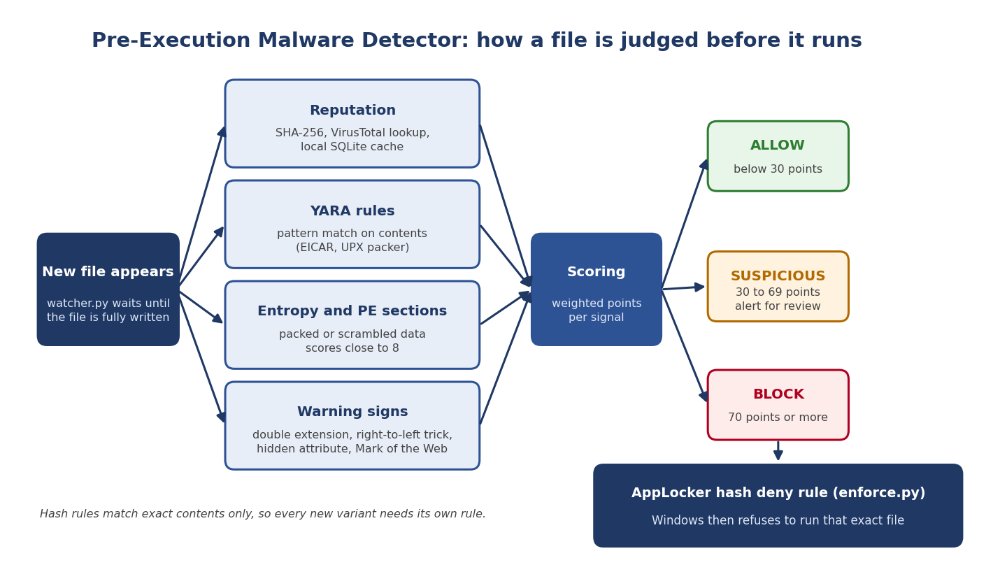

# Pre-Execution Malware Detector (Windows)

A layered tool that inspects a file **before** it is allowed to run, scores it with several independent signals, and, when the evidence is strong enough, asks Windows itself (AppLocker) to refuse to run that exact file.

> **Status:** working prototype with first controlled experiment completed (offline lab). Larger evaluation against real malware families is planned.



## Why this exists

A trojan `.bat` file on a USB drive ran on Windows without any warning. Only after mounting the drive in Kali Linux, where hidden files were visible and execution was refused, did a hash lookup on VirusTotal identify it as a trojan.

Windows antivirus does scan files, but it can be bypassed by scan exclusions, and a known-bad file can be altered so that its hash no longer matches anything. This project explores a second opinion that does not depend on Defender's settings, and measures where hash-only checks fall short.

## What it does

| Layer | What it checks |
|---|---|
| Reputation | SHA-256 of the file, looked up on VirusTotal, with a local SQLite cache to stay inside the free-tier limit |
| Pattern matching | YARA rules (EICAR test file, UPX packer section names) |
| Static analysis | Shannon entropy of the whole file and of each PE section (via `pefile`) |
| Warning signs | Double extension (`invoice.pdf.exe`), right-to-left filename trick, hidden attribute, Mark of the Web (`Zone.Identifier`) |
| Scoring | Weighted points per signal, one verdict per file |
| Enforcement | For BLOCK verdicts, creates an AppLocker SHA-256 hash **deny** rule for that file |

### Scoring (starting weights, not yet tuned)

| Signal | Points |
|---|---|
| VirusTotal: 15 or more engines | 80 |
| VirusTotal: 5 to 14 engines | 40 |
| VirusTotal: 1 to 4 engines | 10 |
| YARA rule matched | 30 |
| High entropy (over 7.0, files of 4 KB or more) | 20 |
| Double extension | 30 |
| Right-to-left filename trick | 40 |
| Hidden attribute | 10 |
| Downloaded from the internet (Zone.Identifier) | 10 |

Verdicts: **ALLOW** below 30, **SUSPICIOUS** from 30 to 69, **BLOCK** at 70 or more.
A signal with no information (for example, a hash VirusTotal has never seen) adds zero points. It is never treated as "safe".

## What was observed

First controlled experiment (offline lab, November 2026):

| File                  | Category | Hash | +YARA | +Entropy | Score | Verdict     |
|-----------------------|----------|------|-------|----------|-------|-------------|
| curl.exe              | Clean    | pass | pass  | FLAG     | 20    | ALLOW       |
| upx.exe               | Clean    | pass | FLAG  | FLAG     | 50    | SUSPICIOUS  |
| curl_appended16.exe   | Variant  | pass | pass  | FLAG     | 20    | ALLOW       |
| upx_appended16.exe    | Variant  | pass | FLAG  | FLAG     | 50    | SUSPICIOUS  |

Key findings:

- A 16-byte append completely changes the file hash. The hash layer alone cannot stop the modified sample.
- The same YARA rule (`UPX_Packed_Section_Names`) and high-entropy flag still fired on the modified `upx.exe`. Structural signals survived the change.
- Packing is currently double-counted (YARA + entropy), so a legitimate UPX binary already scores 50 (SUSPICIOUS). This needs weight tuning.
- When VirusTotal was unreachable the tool correctly added zero points and did not treat the file as safe.
- A clean high-entropy file (`curl.exe`) stayed at 20 points (ALLOW).

These results come from a small, controlled set and demonstrate the intended effect. A larger evaluation with more clean files and malware families is planned.
## Quick start

Tested on Windows 11 Enterprise (evaluation) with Python 3.13, inside a virtual machine.

```powershell
git clone <this repository>
cd pre-execution-detector
py -3.13 -m venv venv
venv\Scripts\Activate.ps1
python -m pip install -r requirements.txt
```

Put your own VirusTotal API key in a private file **outside** the project:

```powershell
mkdir $HOME\.config\pre_execution
notepad $HOME\.config\pre_execution\vt_key.txt   # paste the key only, then save
```

Score one file:

```powershell
python scoring.py path\to\file.exe
```

Watch a folder (new files are scored as they appear). Run this in an **administrator** window if you want BLOCK verdicts to create AppLocker deny rules:

```powershell
python watcher.py
```

Compare the detection stages (hash only, plus YARA, plus entropy) on a file:

```powershell
python pipeline.py path\to\file.exe
```

## Project layout

| File | Purpose |
|---|---|
| `hasher.py` | SHA-256 of a file, read in chunks |
| `vt_check.py` | VirusTotal hash lookup |
| `scan.py` | Lookup with a local SQLite cache |
| `yara_scan.py` and `rules/` | YARA scanning and rules |
| `entropy.py` | Whole-file and per-section entropy |
| `heuristics.py` | Filename, attribute and Mark of the Web checks |
| `scoring.py` | Weighted scoring and verdicts |
| `pipeline.py` | Hash-only, plus YARA, plus entropy stage comparison |
| `enforce.py` | Creates AppLocker hash deny rules (skips files already denied) |
| `watcher.py` | Watches a folder and runs the whole pipeline on new files |

## Safety

- **No malware is included in this repository.** The only test content is the harmless EICAR antivirus test string.
- `.gitignore` excludes sample folders, executables, the cache database, AppLocker policy dumps and key files.
- Never commit your VirusTotal API key. The code reads it from a file outside the project.
- Run experiments in an isolated virtual machine with snapshots, and keep real samples off any machine with internet access.
- `enforce.py` changes the machine's AppLocker policy. Try it only in a lab VM, start in audit mode, and keep a snapshot.

## Limitations

- Hash deny rules match exact contents only. Every new variant needs its own rule, so a modified file can run until it is scored and denied.
- Scoring weights and thresholds are starting guesses and have not been tuned on labeled data.
- AppLocker uses its own file hash, which differs from a plain SHA-256, so deny rules must be created through AppLocker's commands and cannot be built from VirusTotal data.
- Only executable files are covered. Script files such as `.bat` need AppLocker script rules, which are not set up yet.
- The Mark of the Web stamp is not always present and it spreads to copied files, so it can mislead.
- Enforcement silently stops if the Windows **Application Identity** service is stopped. During testing the service had stopped, and files that should have been denied ran with no log entry at all. The tool does not yet check for this.
- In my test, a denied file still ran when started from an **elevated (administrator)** window, and was blocked when started from a normal window. I have not worked out why, so treat enforcement as protection for ordinary-user sessions only.
- Allow-list enforcement is easy to get wrong. With Exe rules enforced and no packaged-app rules configured, Windows blocks **all** packaged apps, including the Start menu and Windows Terminal, and this locked me out of my own VM desktop twice. Create the default packaged-app rules before turning on enforcement, test in audit mode first, and keep a snapshot.
- The cache never expires, so a file unknown today stays "unknown" even if VirusTotal learns it later.
- VirusTotal's free tier allows 4 lookups per minute and 500 per day.
- Tested only on harmless samples and one packer.

## Roadmap

- Evaluation on several malware families and their variants, with detection and false-positive rates for each stage
- Tuning of the scoring weights and thresholds on labeled data
- Script (`.bat`) coverage and a signature check
- Removable-drive origin check
- Blocking at process launch using Sysmon events
- A small dashboard

## License

MIT. See `LICENSE`.
